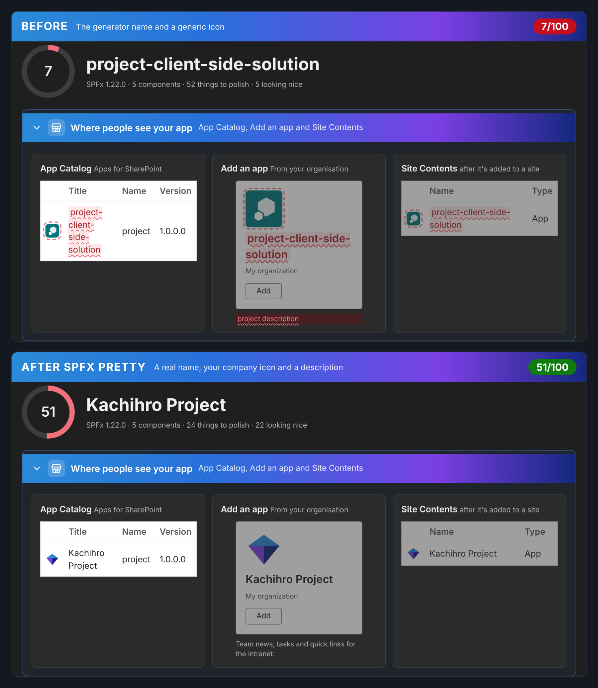
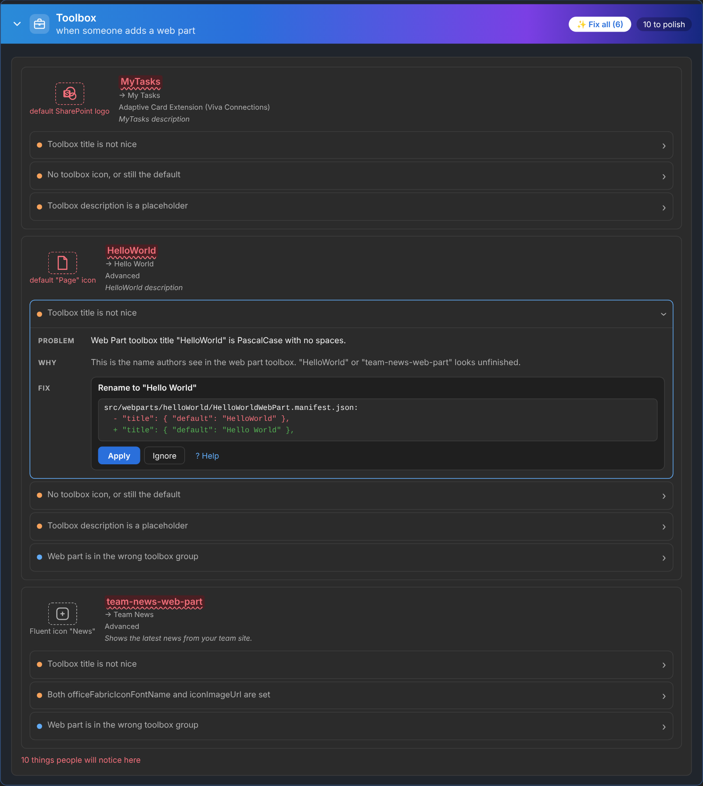

# SPFX Pretty ✨

**Make your SPFx apps look professional where people actually see them** - the App Catalog, Site Contents, the web part toolbox, the property pane and Teams.

## What it does

- 🏷️ **Nice names** - no more `project-client-side-solution` in the App Catalog
- 🎨 **Icons** - your company logo for the app, toolbox and Teams, in one click
- 🧹 **Leftover defaults** - "Description Field", "Test message", unused properties
- 🔢 **Versions** - React / Node / SPFx mismatches and an upgrade plan with effort

…and much more:

- ▶ **Fix step by step** - every issue, worst first: fix, explain, skip or ignore
- 👀 **See before you apply** - every fix shows the exact lines it will change; nothing is touched until you click Apply
- 🧰 **Toolbox** - real toolbox sections (custom groups land in "Advanced"), icons that stand out, proper descriptions
- 🧩 **Unused properties** - properties nobody reads, leftover manifest defaults, property pane typos, dead loc strings
- 🎨 **Branding** - theme colours and section backgrounds, SharePoint Brand Center fonts
- 📚 **Help for every rule** - why it matters and exactly how to fix it, in VS Code and on the website

## Install

In VS Code: **Extensions** (`Ctrl+Shift+X`) → search **SPFX Pretty** → **Install**.

## How to use

1. Open an SPFx project and click the **SPFX Pretty** icon in the Activity Bar (or set **SPFX Pretty › Location** to *explorer* to have it next to Outline)
2. The report opens - click **▶ Fix step by step** to go through every issue one at a time
3. Or click **✨ Fix all** on a section, a button on any item, or **? Explain** for help

## Commands

| | |
|---|---|
| **Scan Project** | Re-scan and open the report |
| **Upload Company Logo** | App Catalog, Teams and toolbox icons from one PNG |
| **Version Check & Upgrade Assessment** | Upgrade plan as Markdown |
| **Fix Step by Step** | Every issue, one at a time - fix, explain, skip or ignore |
| **FAQ - What Each Finding Means** | Help for every rule, with search |
| **Apply All Safe Fixes** | Everything that doesn't need a human |

More: [FAQ for every rule](docs/faq/README.md) · [rules, settings and CLI](docs/RULES.md)

## About

SPFX Pretty is made by **[Kachihro](https://www.kachihro.com)** - Microsoft 365 and Azure projects done properly.
Source and issues: [github.com/kachihro/SPFX-Pretty](https://github.com/kachihro/SPFX-Pretty)
